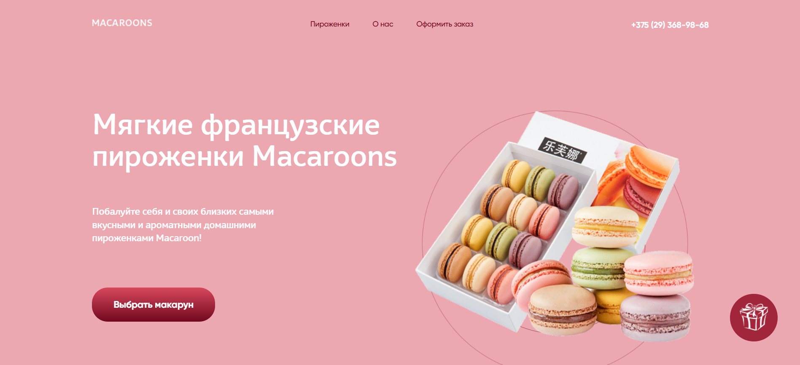
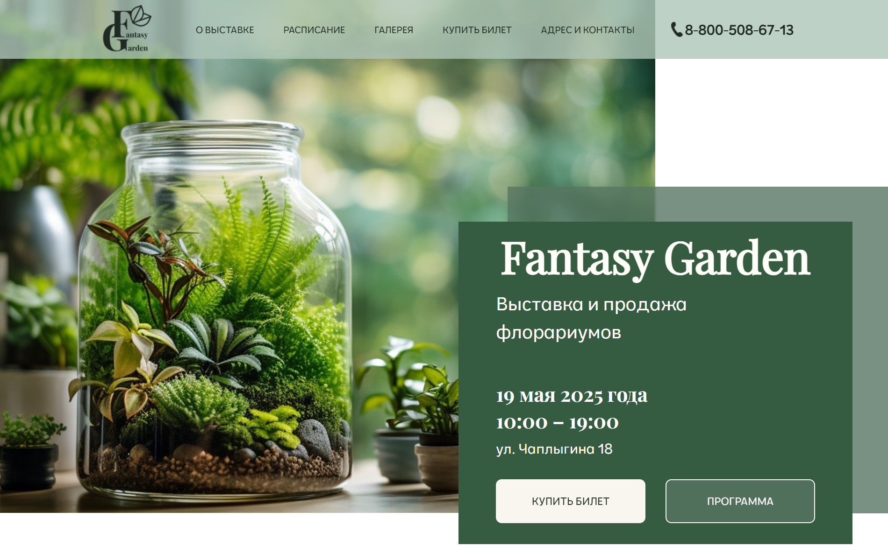

## Привет! Я Mit-10 👋

**Frontend-разработка · Создание веб-интерфейсов**

Развиваюсь во frontend-разработке и создаю современные, удобные и адаптивные веб-интерфейсы.

Мне интересно не просто писать код, а понимать, как устроены приложения, почему решения работают именно так и как сделать пользовательский опыт лучше.

---

### 🛠 Технологии

  
  
  
  
  
  
  

---

### 🎯 Сейчас в фокусе

- Углубление знаний JavaScript
- Создание самостоятельных веб-проектов
- Развитие навыков frontend-разработки
- Работа над качеством кода и структурой приложений

---

### 🚀 Проекты
# Macaroons

## 🍬 Macaroons — сайт-каталог

Адаптивный сайт-каталог французских пирожных с интерактивным слайдером, мобильной навигацией и формой заявки.
##
Стек: HTML5 · CSS3 · JavaScript · jQuery · Slick Slider

 <a href="https://macaroons-ruby.vercel.app">- Live Demo</a>
 
 <a href="https://github.com/Mit-10/macaroons">- Исходный код</a>

---

# Fantasy Garden 🌿

Одностраничный адаптивный сайт для презентации выставки и продажи билетов на мероприятие **Fantasy Garden**, посвящённое флорариумам и комнатным растениям.

## О проекте

Сайт знакомит посетителей с выставкой: рассказывает о флорариумах, программе мероприятия и спикерах, показывает фотогалерею и предлагает выбрать билет.

Проект выполнен с использованием HTML, CSS и JavaScript. Интерфейс адаптируется под разные размеры экранов, а интерактивные элементы помогают пользователю ориентироваться по странице и взаимодействовать с формой заказа.

## Функциональность

- Адаптивная вёрстка для desktop, tablet и mobile
- Навигация по разделам страницы и мобильное бургер-меню
- Фиксированная шапка при прокрутке
- Анимированная бегущая строка
- Слайдер фотогалереи на Swiper
- Анимации появления блоков при прокрутке
- Карточки тарифов с выбором стоимости билета
- Модальное окно оформления заказа
- Проверка обязательных полей, способа оплаты и согласия на обработку данных

## Технологии

- **HTML5** — структура страницы
- **CSS3** — стилизация, Flexbox, Grid и адаптивная вёрстка
- **JavaScript** — интерактивность
- **jQuery** — обработка событий и AJAX-запрос
- **Swiper** — слайдер галереи
- **WOW.js** и **Animate.css** — анимации при прокрутке

 <a href="https://fantasygarden.vercel.app">- Live Demo</a>
 
 <a href="https://github.com/Mit-10/Fantasy_Garden">- Исходный код</a>

 

### 📫 Контакты

- GitHub: [@Mit-10](https://github.com/Mit-10)

*Build · Learn · Grow*

